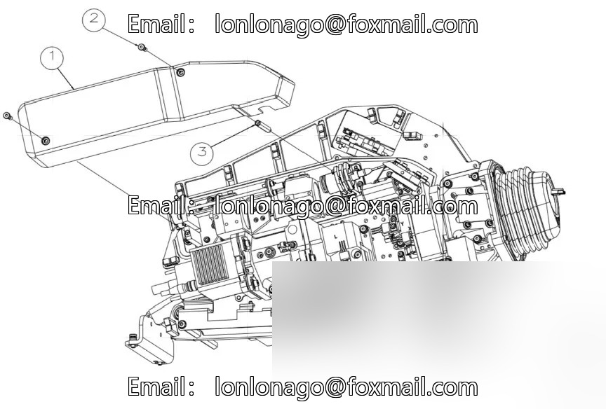
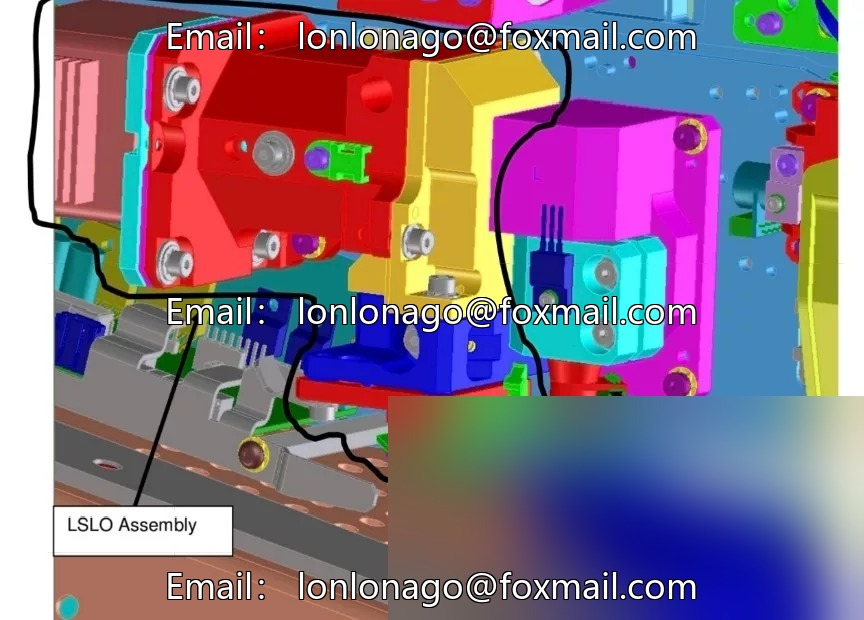
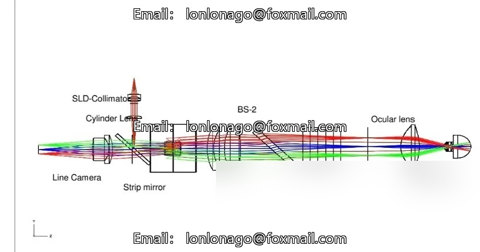

# ZEISS OCT scanner technical data

## Body

ZEISS OCT scanning equipment technical data - ZEISS high-definition optical coherence tomography equipment data
PDF , 480 pages
17754
Content covers instrument structure, optical principles, system composition, operation methods, and application cases, suitable for reference in fields such as optical detection, medical imaging, and industrial non-destructive testing.
non-refundable upon sale.

The technical material covers ZEISS OCT scanners, including instrument structure, optical principles, system components, operation methods and application cases, and is presented as a PDF of 480 pages with 17754 items; the image shows NCON, LSLO Assembly, SLD-Collimato, BS-2, Cylinder Ler, ocular lens, Line Camera and Strip mirror.

<!-- AI_ENRICHED -->

## Images

## Payment

Here is a pay link on Stripe ( https://buy.stripe.com/3cs8yP7sY87d0vu9AB ). Please contact me lonlonago@foxmail.com after funding $89, and I will send you a complete data files , thank you!

